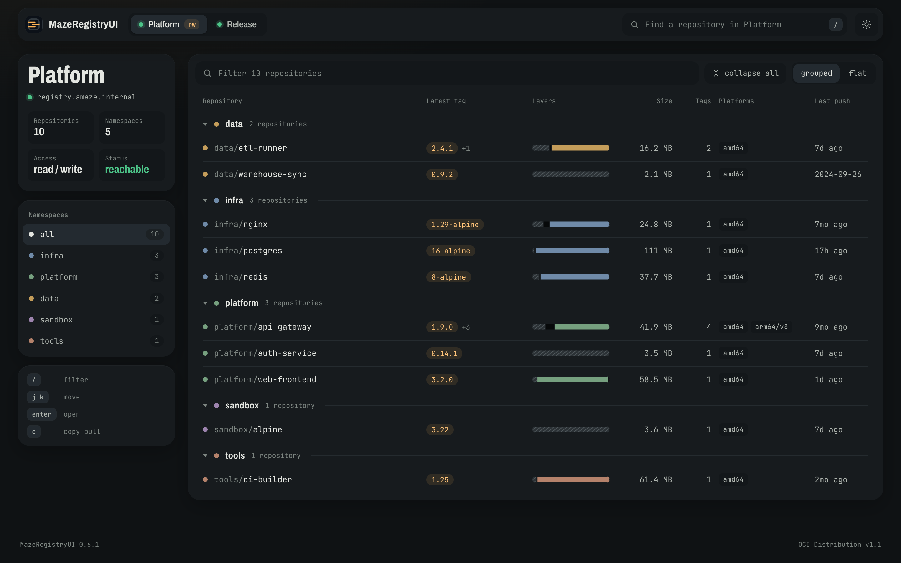
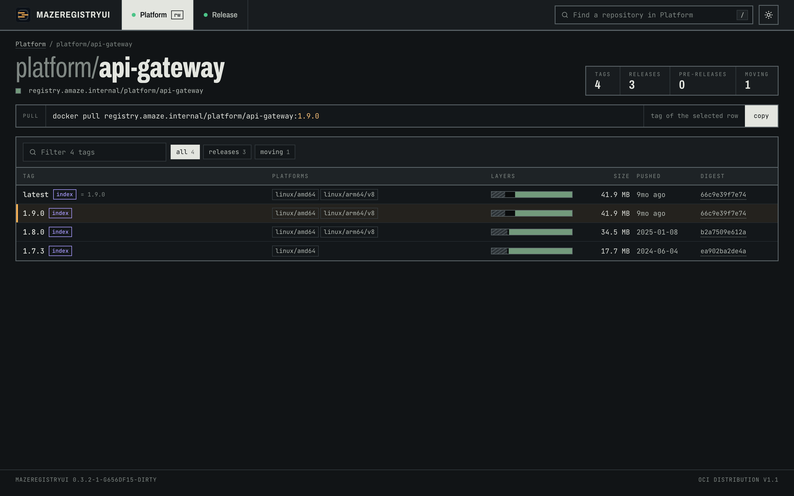
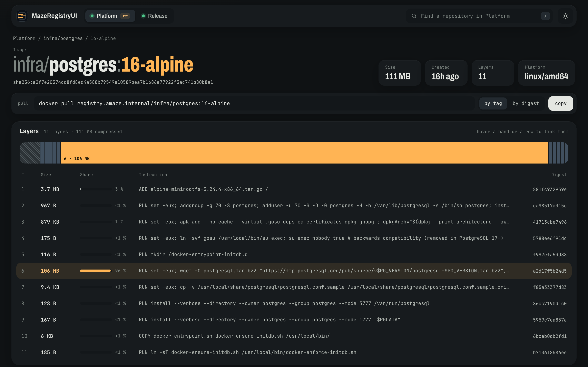

# MazeRegistryUI

A self-hosted **web UI for your OCI and Docker registries**: every repository,
tag, layer and manifest of as many registries as you run — server-rendered,
one binary and one config file, light enough for a phone.



## What it does

- **Every registry in one place** — one tab per registry, each with its own
  credentials, timeouts and permissions; a live reachability check on each.
- **A catalog that scales** — repositories grouped by namespace, each row with
  its newest tag, size, platforms, age and a layer strip. Large registries
  load a group the first time it is opened; search is instant, from any page.
- **Tags and images in depth** — tags filtered by kind (releases,
  pre-releases, moving tags such as `latest` and the version they point at),
  the layer composition with the build command behind each layer,
  multi-architecture indexes, labels, environment, annotations and the raw
  manifest.
- **Made for daily use** — a copyable `docker pull` by tag or by digest,
  keyboard navigation (`/`, `j`/`k`, `enter`, `c`), dark and light themes, and
  manifest deletion where you allow it.
- **Works with what you run** — OCI Distribution v1.1: Distribution 3.x,
  Harbor, GHCR, Gitea, Zot, Artifactory. Anonymous, basic, bearer token and the
  token-service handshake.
- **Credentials stay on the server** — the browser never talks to a registry:
  every call is proxied, so tokens never reach the page and no registry needs
  CORS.
- **Light footprint** — a single static binary in a distroless image, no
  database, no Node, no CDN: it runs air-gapped and the pages work before any
  script loads.

| | |
| --- | --- |
|  |  |
| **Repository**: tags resolve as they scroll into view; the pull bar follows the selected row | **Image**: the layer composition, the configuration and the raw manifest |

## Quick start

You need Docker with the Compose plugin. Save this as `config.yaml`, with your
registry's address — the root, **without** `/v2`:

```yaml
registries:
  - name: Homelab
    url: http://registry.example.com:5000
    auth:
      type: none
```

and this as `docker-compose.yml` next to it:

```yaml
services:
  mazeregistryui:
    image: ghcr.io/amaze-labs/mazeregistryui:latest
    restart: unless-stopped
    ports:
      - "127.0.0.1:8080:8080"
    volumes:
      - ./config.yaml:/etc/mazeregistryui/config.yaml:ro
    read_only: true
    tmpfs:
      - /tmp:size=16m
    cap_drop: [ALL]
    security_opt: [no-new-privileges:true]
```

Then:

```bash
docker compose up -d
```

Open <http://localhost:8080>. To add a registry, list it in `config.yaml`
and run `docker compose restart`: the file is the whole configuration, there
is nothing to set up in the UI. Credentials go in environment variables, referenced from the file
as `${VAR}` — see [Configuration](docs/CONFIGURATION.md#secrets).

Want to look around first? Clone the repository and start the
[demo registries](docs/demo/seed.sh) — the data in the screenshots above:

```bash
sh docs/demo/seed.sh                          # two invented registries, in Docker
make build && bin/mazeregistryui -config docs/demo/config.yaml
```

then open <http://127.0.0.1:18080>. `sh docs/demo/seed.sh down` removes them.

Behind a reverse proxy, on a sub-path, on Kubernetes or as a systemd service:
see [Deployment](docs/DEPLOYMENT.md).

## Documentation

| | |
| --- | --- |
| [Configuration](docs/CONFIGURATION.md) | Every field with its default, credentials, worked examples, troubleshooting |
| [Deployment](docs/DEPLOYMENT.md) | Docker, Compose, Kubernetes, reverse proxies and TLS, authentication in front, releases |
| [Architecture](docs/ARCHITECTURE.md) | How a request travels, the caches, the security posture — for people changing the code |
| [Contributing](CONTRIBUTING.md) | Running from source, tests, commit conventions |

## License

GNU Affero General Public License v3.0 or later — see [LICENSE](LICENSE).

Running it unmodified, privately or at work, asks nothing of you. If you
modify it and let other people use your version over a network, you must
offer them the source of that version too — the footer's source link is the
place for it, and a modified build should point it at its own source
(`-ldflags "-X github.com/amaze-labs/MazeRegistryUI/internal/version.Source=…"`).
The same goes for distributing a modified build.

Bundled third-party components — htmx (0BSD), the Archivo and JetBrains Mono
fonts (OFL-1.1) and gopkg.in/yaml.v3 (MIT and Apache-2.0) — keep their own
licences: see [THIRD-PARTY-NOTICES.md](THIRD-PARTY-NOTICES.md).
